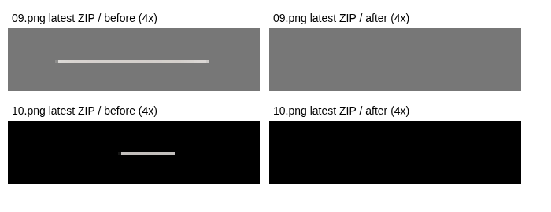

# 最新実ZIP：手動選択なしの上端残留線自動除去

## 前回と今回の違い

前回までの実画像テストは「候補を選んで削除した後」のPNG／ZIPを検証していました。候補を一度も選ばずに書き出す手順では、検出しても承認待ちのため線を残す仕様でした。テスト成功を、そのまま自動出力での解決とみなすことはできませんでした。

今回の回帰テストは、最新の実PNGを読み込み、**編集画面を開く前に、そのままZIPを書き出す**手順です。検出関数に09・10のファイル名や座標を与えず、全スタンプへ同じ自動判定を適用します。

## 実データで確定した値

今回添付された`line-stamps-test-10.zip`（12画像）を直接展開・解析しました。前回のPNGと混同していません。

| 画像   | 位置（左上0始まり） | 寸法   | 色の範囲 R / G / B             | アルファ値           | 自動処理後       |
| ------ | ------------------- | ------ | ------------------------------ | -------------------- | ---------------- |
| 09.png | 左155・上25px       | 49×1px | 225〜235 / 219〜232 / 215〜229 | 54〜221、47画素が221 | 49画素すべて透明 |
| 10.png | 左175・上25px       | 18×1px | 233〜236 / 230〜234 / 223〜230 | 24〜211、17画素が211 | 18画素すべて透明 |

**今回の10.pngは16pxではなく18px**です。どちらも本体から離れた、薄い中性色の半透明な1行です。線の内部に微細なRGB差があり、不透明度の大半は同一です。



## 自動削除する範囲と保護

`residue.js`の`automaticLines`は、次の条件を**すべて**満たす場合だけ自動対象にします。

- 完成画像の上約16%以内。本体より上に少なくとも12px程度離れている。
- 密につながった横1行だけ。幅12px以上、本体幅の35%以下、面積は本体の0.5%以下。
- 本体の中央寄り（中心から本体幅の15%以内）。大きい本体成分が存在する。
- 全画素が半透明で、完全不透明な画素を含まない。各RGB値は200以上で、色差は小さい。
- 4種類以上の微細なRGB差があり、80%以上の画素のアルファ値が同じ。均一色の薄い動き線は確認候補に残す。
- 既存の保護判定に該当しない。

これは、意味を理解するAIやOCRではなく、自動対象を限定するヒューリスティックです。**この条件だけで背景由来と証明できるわけではありません。** 太い影・ハート・涙・煙・葉・輪郭・白い内部、濃い／色付き／完全不透明な動き線、本体に近い線は対象外です。今回の実10枚では、これらを含むすべての他画素が不変であることを確認しました。

一方、任意のキャラクターで意味的な100%の区別を保証することはできません。同じ特徴を持つ特殊な装飾は誤判定の可能性があるため、**前後比較と画像ごとのOFFによる完全復元**を設けています。番号・不確実な点・2行以上の線・色付きの線・条件外の残留物は自動で消さず、既存の確認候補・拡大・消しゴム・取り消しを利用します。任意の番号を自動認識して消す機能ではありません。

## 実装

- `core.js`：既存の拡大・位置・文字の配置計算後、文字を描く直前のキャラクター層を検査し、対象の1行矩形だけを`clearRect`。文字レイヤーはその後に合成するため、自動除去が新しく入力したセリフ・白フチ・影を削ることはない。元画像・ネイティブマスク・配置は書き換えず、除去後にキャラクターを再拡大もしない。
- 同ファイル：`renderUncleaned`で、同じ配置・文字の自動除去前の描画を取得。既存の編集画面・単体PNG・一覧・ZIP・メイン・タブは共通の`renderStamp`を使うため、通常出力にも自動処理が適用される。
- `app.js`／`index.html`：標準ONの自動除去チェック、実行件数、前後比較を追加。自動除去した元画像候補は「自動除去済み」とし、再度手動で選ぶ必要をなくした。未解決候補の警告は実際の完成PNGを基準にする。
- `project.js`：画像ごとの`cleanupEnabled`を任意の真偽値としてJSONに保存。古いJSONではONとし、OFFも再読込後に維持。不正な型は拒否。従来の形式バージョン、セリフ、番号、配置、消しゴム差分は維持する。
- `styles.css`：iPhone相当の画面で前後比較を開いたとき、固定プレビューが比較画面を覆わないよう調整。
- 関連JS・CSSの参照に同じ新バージョンを付け、古いファイルとの混在を避ける。

## 確認できた結果

1. **元ZIPからの自動処理**：全12画像へ同一判定を適用し、09の49画素・10の18画素だけを除去。他の全RGBA画素が一致。01〜08・main・tabはPNGファイルのバイト列も完全一致。ZIPを再展開してPNGの一致とCRCを検査。
2. **実アプリの手動操作なし出力**：最新10枚を個別画像として読み込み、候補選択なしで即ZIP出力。09・10だけで計67画素が変わり、その他の全RGBA画素が自動処理前の同じ完成描画と一致。単体PNG・一覧・ZIPも一致。
3. **2列×5段の分割経路**：最新の完成PNG10枚を透明な740×1600pxの一覧へ再構成して読み込み、通常の分割経路でも同じ自動除去と全画素比較を確認。この一覧はテスト用再構成であり、利用者の加工前の白背景一覧そのものではない。
4. **装飾の保持**：実10枚の動き線、涙、煙、ハート、白いお腹、葉、影はすべて線以外の全画素一致で検査。単色の薄い動き線などを自動対象から外す否定テストも追加。
5. **文字**：実09に6種類の日本語文字デザインを合成し、自動処理前後の差が元の49画素だけで、文字・本体の画素、配置、重なり検査が変わらないことを確認。
6. **操作**：自動除去前後の比較、OFFで元の描画へ完全一致、ONで除去後へ完全一致、OFFのJSON保存、手動修正への切替を確認。
7. **既存機能**：単体41件と、従来のブラウザ回帰（10／40枚、8／16／24／32／40枚、自由分割、JSON、文字デザイン・自動配置、消しゴム、にじみ提案、メイン・タブ・ZIP）を実行。

## 未確認・残る制限

提示された元一覧画像は画面上で確認できましたが、この作業環境には元PNG/JPEGファイルとして展開されていません。そのため、元画像の分割境界が上段の薄い影を切ったのか、縮小・補間のどの段階で1行になったのかを画素で断定していません。工程特定には、**元一覧画像をPNG/JPEGファイルとして添付したものと、そのときの分割・切り抜き・透過・倍率設定（保存JSON）**の照合が必要です。

今回確認したのは、添付実ZIPに存在する線を、実アプリの通常出力で手動選択なしに消せることです。任意の入力画像、任意の拡大・回転後の線や、全番号の自動除去を保証していません。実機Safariも未検証で、ChromiumのiPhone 13相当の画面・タッチ設定での検証です。外部API・画像送信・追加料金はありません。

## 再実行

実画像全体はコミットせず、線の実RGBA値と元PNGのSHA-256だけを小さいフィクスチャに収録しています。

```sh
node --test tests/core.test.cjs tests/project.test.cjs tests/typography.test.cjs tests/residue.test.cjs tests/real-line.test.cjs tests/auto-cleanup.test.cjs
# READMEのローカルサーバー／Playwright準備後、最新ZIPをローカルのフォルダーへ展開
NODE_PATH=/tmp/stamp-browser-tests/node_modules STAMP_TEST_URL=http://127.0.0.1:4600 STAMP_AUTO_INPUT=/tmp/stamp-auto-input STAMP_TEST_ARTIFACTS=/tmp/stamp-automatic-results node tests/automatic-real-browser.cjs
python3 tests/verify_automatic_browser.py /tmp/stamp-automatic-results
# 同じPNGから再構成した2列×5段の経路（出力先を分ける）
NODE_PATH=/tmp/stamp-browser-tests/node_modules STAMP_TEST_URL=http://127.0.0.1:4600 STAMP_AUTO_INPUT=/tmp/stamp-auto-input STAMP_TEST_ARTIFACTS=/tmp/stamp-automatic-grid node tests/automatic-real-browser.cjs --grid
python3 tests/verify_automatic_browser.py /tmp/stamp-automatic-grid
# 実ZIPの自動処理と全RGBA・ZIP内容の独立検証
python3 tests/automatic_zip_repair.py /path/to/line-stamps-test-10.zip /tmp/stamp-auto-corrected
```
