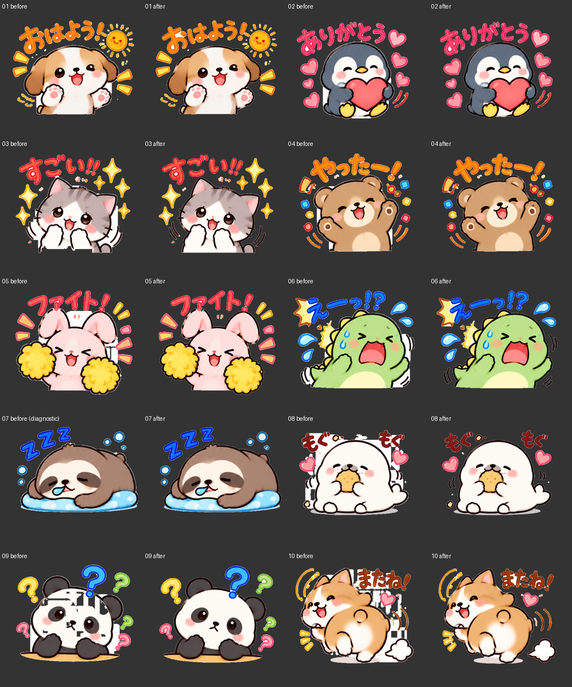

# PR #67：元画像10コマの切り抜き修正と比較

最新の白縁軽減と白・黒・チェック柄比較は[外周白縁の検証](fringe-review.md)を参照。本書はその前段の記録。

**判定：全10枚とも未合格。** 大きな背景の復元・顔の透明化・07の停止は改善したが、濃色背景で拡大すると細い明色の縁が残る。機械検査の成功を画像品質の合格と扱っていない。PRは下書きのままとし、マージしていない。

## 入力・条件

- 元画像：[PR内の元一覧PNG](../tests/fixtures/BBE9DC5F-F70D-490D-B5E3-40E2D682218B.png)、916×1717。
- SHA-256：`31f7b0a2f675a3bc67e964363a2702f0e7260388a9b2c81ae620065510910291`。
- 修正前：`695c6fcc5f662bab75d054ddd1a7991efa84d35b`。加工済みZIPから一覧を再構成したテストではない。
- 自動背景判定・許容差24・2列×5段・切抜き余白0。列ごとに分割位置を検出。分割失敗時の均等分割への置換はしていない。
- 全コマのネイティブ解像度PNGを元画像と目視比較。濃いグレーで原寸・拡大確認し、通常アプリの370×320 PNG・ZIPも生成。
- **07の修正前は実アプリでは停止する。** 比較図の07左側は、停止を迂回し同じ矩形から従来のマスクだけを生成した診断用画像。正常に書き出せた画像として数えていない。
- この設定では03の修正前の大きな前足欠損は再現しなかった。周囲の背景残りは再現した。利用者の全設定が取得できたという意味ではない。

## 比較画像・成果物

各番号の左が修正前、右が修正後。07左は上記の診断用再構成。



[原寸比較・実アプリ出力をまとめたZIP](cutout-review-assets.zip)をダウンロード・展開し、`review.html`をブラウザで開くと、元画像／修正前／修正後を並べ、背景を黒・白・ピンク・グレーに変更できる。各PNGを別タブで開いて拡大可能。`final/01.png`〜`10.png`は通常アプリの出力、`app-10.zip`は実際に書き出したZIP。

[画素検査・切抜き位置のJSON](cutout-evidence/evidence.json)に全コマの矩形、警告、停止、保持画素数を記録した。修正前後で07〜10の一部の矩形も変わるため、単純な同一座標の差分だけで品質を評価していない。

## 画像ごとの確認結果

「目視なし」は完全な正解マスクで証明した意味ではない。元絵の胴体が平らに終わる部分は元画像由来であり、新規の切断と区別した。境界付近の自動警告も合格保証として扱っていない。

| 番号 | 修正前の確認 | 修正後の欠損 | 背景残り（修正後） | 隣接画像の混入 | 処理による新規切断 | 判定 |
| --- | --- | --- | --- | --- | --- | --- |
| 01 | 文字・輪郭周辺の明色の縁 | 大きな欠損は目視なし。顔・前足・胸を保持。開いた下端は形状推定 | 文字・太陽・輪郭に細い明色の縁 | 目視なし | 目視なし。元絵の平らな胴体下端を維持 | 未合格 |
| 02 | 文字・ハート・外周に明色の縁 | 顔・腹・足・ハート・動線を目視保持 | 文字・ハート・外周に細い明色の縁 | 目視なし | 目視なし。下端近接の自動警告は残存 | 未合格 |
| 03 | 前足の大きな欠損は今回条件では再現せず。動線付近に背景残り | 白い両前足・顔を目視保持。開いた下端は形状推定で要確認 | 動線周辺の広い白を除去。ただし輪郭・文字・星に細い明色の縁 | 目視なし | 目視なし。元絵の平らな下端を維持 | 未合格 |
| 04 | 文字・装飾・外周の背景残り | 顔・腹・両手・装飾を目視保持 | 文字・装飾・輪郭に細い明色の縁 | 目視なし | 目視なし。下端近接の自動警告は残存 | 未合格 |
| 05 | 耳の周囲・動線状装飾に広い背景残り | 耳・顔・体・ポンポン・装飾を目視保持 | 広い白は改善。文字・耳・ポンポンに細い明色の縁 | 目視なし | 目視なし。上下端近接の自動警告は残存 | 未合格 |
| 06 | 動線付近などに広い背景残り | 体・腹・涙・動線を目視保持。輪郭推定の警告あり | 広い白は改善。文字・体・涙に細い明色の縁 | 目視なし | 目視なし。元絵の平らな下端を維持 | 未合格 |
| 07 | 「連続した色付き画素12個」で停止。比較左は診断用 | 停止せず生成。顔・手・浮き輪・泡・Zを目視保持 | 浮き輪下部・輪郭・文字に明色の縁 | 目視なし | 目視なし。上下の正常画素の接続を調べる判定へ変更。端近接の警告は残存 | 未合格 |
| 08 | 顔・文字・動線周囲に大きな矩形状の白背景残り | 白い顔・胴体・両手・足を目視保持 | 大きな白を除去。文字・輪郭・影の周囲に細い明色の縁 | 目視なし | 目視なし | 未合格 |
| 09 | 顔に大きな透明領域と不連続な白の復元 | 大きな透明化を解消。顔・両手・疑問符を目視保持 | 顔外周・疑問符・台の周囲に細い明色の縁 | 目視なし | 目視なし | 未合格 |
| 10 | 文字・ハート・動線周囲に矩形状の背景残り | 顔・足・体・文字・ハート・動線・煙を目視保持 | 広い白を除去。ただし文字・動線・輪郭に細い明色の縁 | 目視なし | 目視なし | 未合格 |

## 根本の変更

従来は白背景の許容差を12まで狭め、削除後に暗い画素を複数方向へ探して白を復元していた。顔・前足を欠損させる一方、文字や動線の間の背景を矩形状に復元する原因になっていた。

今回は、指定した背景色との差から前景の障壁を作り、小さな輪郭の隙間を形態学的クロージングで閉じてから、外周に連続する背景だけを4近傍で探索する。仮の障壁は画像へ描画せず、RGBも変更しない。囲まれた白い部位は保持する。最大成分だけ残す処理や小成分の自動削除はせず、離れた文字・ハート・動線も対象に含める。

元絵が平らな下端で終わる場合には、同一の連結輪郭に、同じ高さで終わる複数の縦方向の支えと大きな空白があるときだけ仮の下端を閉じる。画像番号・固定座標・猫だけの上方向探索は使わない。**これは形状の仮説であって意味認識ではないため、`inferred-open-outline`として要確認を維持する。** 大きく開いた任意の輪郭やU字形の背景を常に正しく区別できると主張しない。

外周に接する中性色の不透明な縁の1層だけはアルファ値を緩和する。既存の半透明画素・内部の白・色付き画素はこの緩和で変更しない。ただし、白背景が混ざったRGBそのものは補正しないため、**細い明色の縁を取り切れていない**。その除去と、開いた白い輪郭のより確実な保護は残課題。

切断チェックは、切抜き枠上の色付き画素だけで停止せず、元画像の枠の内側2画素・外側2画素に連続した絵柄がある場合に停止する。真の切断を止める単体テストを四辺に追加した。小さな・淡い・斜めの切断はこの強い停止条件では取りこぼす可能性があるため、端付近の目視確認用警告は維持する。

分割処理の「5段目だけ早めに切る」「3段目だけ許容密度を上げる」などの特定配置に合わせた例外も削除し、全行に同じ条件を適用した。1段画像には複数段用の自動境界検出を要求しない。開発用回帰画面も、失敗時に均等分割へ戻さない。

## 実行した検査

- 単体テスト：16ファイル・72テスト。輪郭の小さな隙間、開いた白い下端、離れた装飾、灰色がかった背景、元から半透明の画素、四辺の真の切断と正常な終端を含め、全件成功。
- 元画像全10コマ：背景色との差が56を超える548,918画素と、色差が24を超え背景許容差の外にある516,344画素のアルファ値を保持。RGBは元画像から変更していない。この数値は意味上の全前景を保証するものではない。背景と近い淡色の装飾は完全には判別できない。
- ChromiumのiPhone 13相当で通常アプリに元画像を読み込み、10枚生成・PNG保存・ZIP保存を実行。ページエラーなし。07でも停止しない。
- ZIP内10枚のPNGは共通の描画関数で得たPNGとバイト一致。12エントリ（10枚＋main＋tab）のCRC正常。
- 1×1画像の読み込み・生成も成功。
- 既存の`tests/browser.cjs`は、色付きの分割線を持つ合成画像の生成待ち（104行）でタイムアウト。**修正前695c6fcを別ディレクトリで実行しても同じ箇所で失敗した。** この既存テストを成功とは報告せず、修正後の実画像テストと区別する。実機Safariは未実施。

再実行（PlaywrightとChromium、ローカルサーバーが必要）：

```sh
node --test tests/*.test.cjs
python3 -m http.server 4173
# 別ターミナル：NODE_PATHはPlaywrightを置いた場所に合わせる
NODE_PATH=/path/to/node_modules STAMP_TEST_ARTIFACTS=work/cutout-comparison node tests/cutout-real-browser.cjs
```

テストの`PASS mechanical checks`は、枚数・色付き画素保持・出力が整合することだけを示す。実画像品質の判定はこの一覧どおり**全10枚未合格**である。
