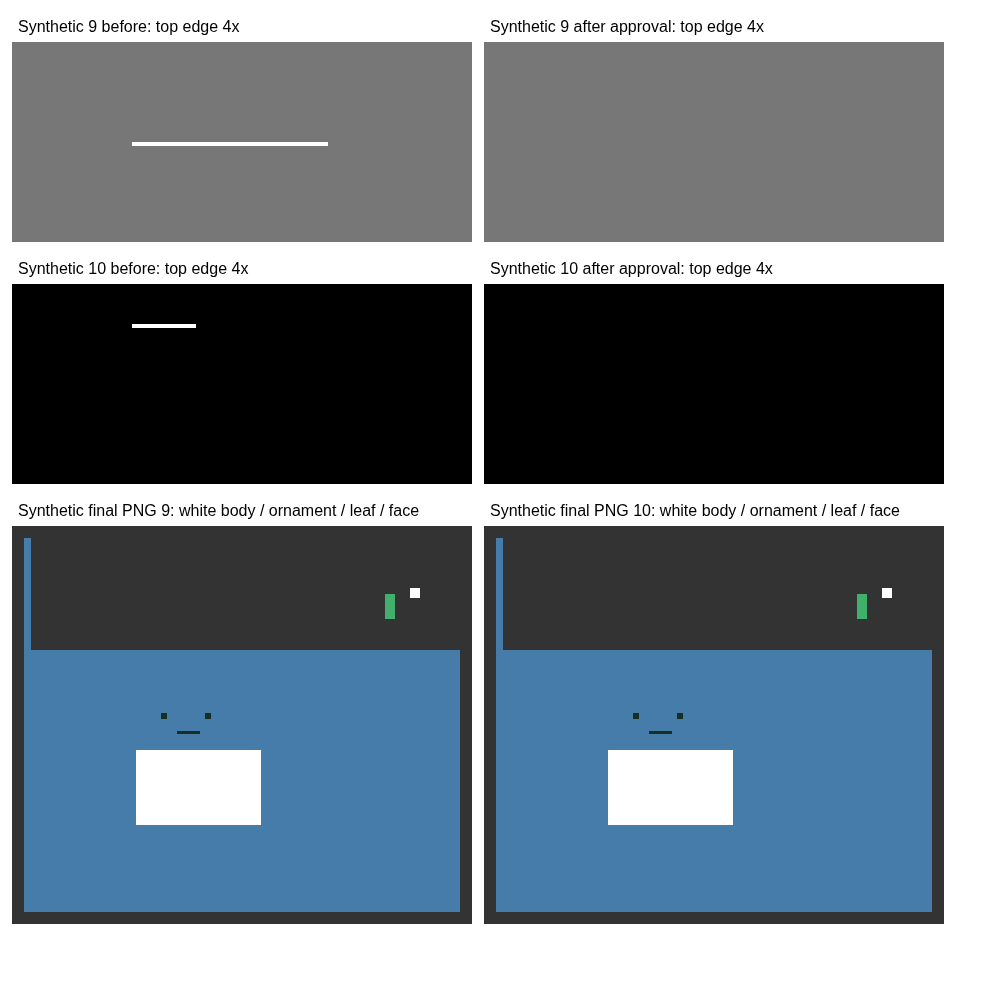

# 上25pxの49×1px線・上10pxの16×1px線：追加調査

## 実ファイルと調査の限界

`line-stamps-test-10(4).zip`、その09.png・10.png、元画像は今回の作業環境にありません。チャットには取得URLや添付ファイルIDもないため、実ファイル固有の発生工程は断定できません。以前のテストで生成したZIPを、利用者の実ZIPとして扱っていません。

今回は報告された**370×320px、09相当は上25px・49×1px、10相当は上10px・16×1px**を正確に再現した合成画像で調査しました。以下の結果は合成画像の結果です。実機iPhone Safariも未検証で、ChromiumのiPhone 13相当の画面・タッチ入力を使用しています。

## 原因：確認できた検出漏れ

前回の切り抜き補間修正はmainにマージ済みでした（ベース：`7542cdd`）。しかし、孤立成分の検出条件に次の見落としがありました。

- 旧処理は「本体の外側」を、最大連結成分を囲む**長方形の外側**として判定。
- 耳・葉・手足などが上へ伸びると、その長方形の中にも外側の空白ができる。
- その空白に浮いた線は本体と離れていても候補にならない。
- 今回の49×1px／16×1pxの合成線は、どちらも旧条件では候補にならないことを自動テストで確認。
- また、申請前の孤立候補検査は元画像マスクが対象であり、文字合成・拡大後の完成画素を直接検査していなかった。

変更した`residue.js`と`app.js`の参照には同じバージョンを付け、更新後のHTMLから古い解析JSだけが読み込まれる混在を避けています。キャッシュが実不具合の原因だったとは断定していません。

候補を自動削除しない動作は誤削除防止のための仕様です。今回も自動削除には変更しません。「候補に出ない問題」と「利用者が承認するまで削除しない仕様」を分けています。

## 工程ごとの確認

| 工程               | 調査結果・今回の対応                                                                                                                                                                                                                                                                                        |
| ------------------ | ----------------------------------------------------------------------------------------------------------------------------------------------------------------------------------------------------------------------------------------------------------------------------------------------------------- |
| 自由分割・切り抜き | 5列×2段の1850×640pxの透明PNGを実際に読み込み、10コマに分割。元の各コマに49×1px／16×1pxの線を入れ、ネイティブ画素の同じ位置に存在することを確認。自由分割の処理は変更していない。                                                                                                                            |
| 背景透過           | 透明な角を持つ画像の元アルファ値を保持する既存動作を維持。白い本体・白い独立装飾を保護。白背景の除去、輪郭内の白保持、消しゴムの既存回帰テストも実行。                                                                                                                                                      |
| 拡大・位置・Canvas | 再現ケースは本体の範囲を350×300pxにし、倍率100%で変換比1・オフセット0を確認できる形にした。これにより元画像の線が完成PNGの同じ49×1px／16×1pxとして残る。今回のケースは元画像の前景が保持されたもので、PNG出力が線を新規生成した例ではない。範囲外の線が補間で混入する前回の51px／16pxの別ケースも回帰検証。 |
| 文字合成           | 既存の文字デザイン・自動配置・自動縮小は変更なし。完成画素の監査時は、同じ`paintPlan`で文字・白フチ・影の被覆を描き、その画素に触れる連結成分を候補から除外。6プリセットで実際の日本語描画を検証。                                                                                                          |
| 候補検出           | 最大成分を障壁として、切り抜き外周から空白領域を4近傍で探索（前景は8近傍）。長方形の内側でも輪郭の外の空白に浮いた線を検出可能にした。閉じた輪郭内の目・口・装飾、斜めの閉じた輪郭を保護。追加対象は本体から最低3px（画像寸法に応じて調整）以内のものを保護し、引き続き細長さ・小ささ・面積の条件も適用。   |
| 削除・PNG・ZIP     | 承認した元画像の候補だけを既存アルファマスクから削除。同じマスクと`renderStamp`を編集画面・一覧・単体PNG・ZIPで使用。出力への別の破壊的フィルターは追加していない。                                                                                                                                         |
| 全画像の最終検査   | 申請前チェックで全スタンプの**完成CanvasのRGBA画素**も解析。元画像・完成画像いずれかに候補があれば番号を表示する。装飾を残す必要があるため非ブロッキング警告。空画像、寸法、透過余白、文字はみ出し／自動配置の重なり、ファイルサイズ・CRCの既存検査も維持。                                                 |

## 修正前後（合成画像・利用者の削除承認後）

| ケース | 修正前：旧検出の候補 | 削除前の完成PNG             | 承認削除後の完成PNG |
| ------ | -------------------- | --------------------------- | ------------------- |
| 09相当 | 表示されない         | 左130px・上25px、白線49×1px | 残留0px             |
| 10相当 | 表示されない         | 左130px・上10px、白線16×1px | 残留0px             |



削除以外の画素が変わっていないことを、ネイティブマスクの全バイトと、独立して復号した完成PNGの**全RGBA画素**で確認。白い本体・白い装飾・葉っぱ・目・口は維持されています。キャンセルで全画素不変、取り消しで削除前、やり直しで削除後に一致。単体PNG保存とZIP内の09.png／10.pngも全画素一致し、全10枚のZIP画像が一覧CanvasのSHA-256と一致しています。

グレー／黒背景の4倍プレビューを保存して確認しています。倍率・背景・枠の変更は出力に入りません。最大8倍とiPhone相当の390px幅、タッチ消しゴムは前回の回帰テストでも継続検証します。

## テスト

アプリの追加依存・外部API・料金はありません。テストのみNode.js、Python標準ライブラリ、ローカルのPlaywright／Chromiumを使用します。新しい生成先を使用し、古いZIPを検証結果に混ぜないでください。

```sh
# READMEに従ってローカルサーバーを起動してから実行
node --test tests/core.test.cjs tests/project.test.cjs tests/typography.test.cjs tests/residue.test.cjs
NODE_PATH=/tmp/stamp-browser-tests/node_modules STAMP_TEST_URL=http://127.0.0.1:4300 STAMP_TEST_ARTIFACTS=/tmp/stamp-exterior-tests node tests/exterior-residue-browser.cjs
python3 tests/verify_exterior_zip.py /tmp/stamp-exterior-tests
```

単体テスト32件はすべて通過。新規の正確な座標・寸法のブラウザテストと、既存4種類のブラウザ回帰テストも通過しています。

追加テストは49×1px／16×1pxに加え、アルファ値1の線、輪郭内の細い口、輪郭に近い表情の部品、斜めの閉じた輪郭、文字保護マスクの寸法不一致を対象とします。

既存の`browser.cjs`、`project-browser.cjs`、`typography-browser.cjs`、`residue-browser.cjs`と対応するZIP検証も実施。8／16／24／32／40枚、従来10枚、5列×2段・混在レイアウト、番号とセリフ、JSON往復、拡大・位置調整、文字デザイン、自動配置、消しゴム、比較、メイン・タブ画像を回帰検証します。現時点の結果と未検証範囲は最終報告で区別しています。

## 利用者の操作と残る確認

「孤立した線・点を拡大確認する」を開き、完成PNGの候補の座標と寸法を確認します。「拡大」で見て、不要な線に対応する元画像候補だけをチェックし「選択した候補だけ消す」を承認してください。装飾は選ばず残せます。完成画像だけに候補が見えるなど対応しない場合は、既存の消しゴム・切り抜きを使用します。

画像の意味を完全に判断する機能ではありません。輪郭から独立した葉っぱ・装飾なども候補になる可能性があります。**自動削除・初期チェックはありません。** 本体とつながる線、閉じた輪郭内の線など、保護を優先して候補にしないものもあります。実ZIPと元画像での発生工程特定・修正確認、および実機Safariでの保存確認は残っています。
