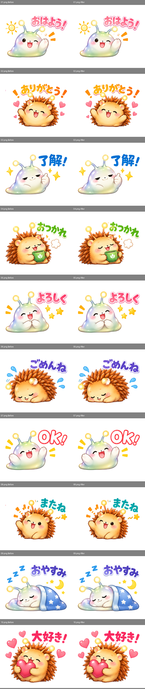
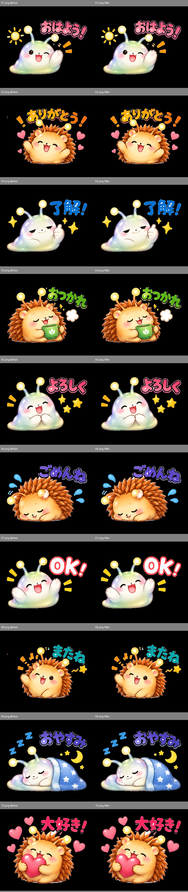
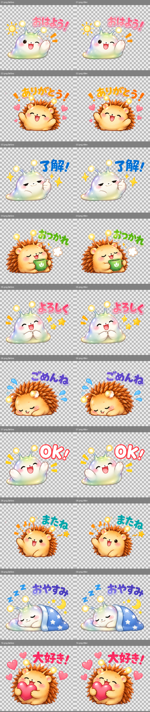
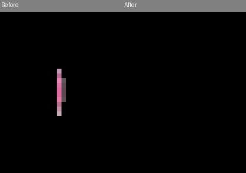
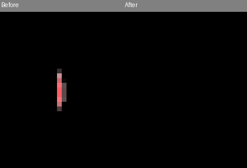

# LINEスタンプ残留物レビュー

添付の完成透過PNGを入力に、全画像を再書き出し。元の生成モデルや元一覧画像からの再生成ではありません。

赤＝削除確認済み、緑＝保持、橙＝要確認（削除しない）。左右は修正前／修正後。

削除は画像SHA-256と成分IDに結び付いた個別の目視レビュー結果だけに適用。検出器は背景由来を意味的に断定せず、色や面積だけで自動削除しません。保持理由も意味認識の保証ではありません。

10枚、変更29画素。RGB全画素不変、選択成分以外のRGBA全バイト不変。

|画像|成分ID|左,上 / 幅×高さ|画素数|アルファ範囲|判定|理由|
|---|---|---|---|---|---|---|
|01.png|9|53,81 / 8×16|99|25–255|保持|文字・装飾・輪郭の細部の可能性があるため保持。濁点・半濁点、ハート、星、動線、触角の光を面積だけで削除しません。|
|01.png|11|71,88 / 13×14|105|1–255|保持|文字・装飾・輪郭の細部の可能性があるため保持。濁点・半濁点、ハート、星、動線、触角の光を面積だけで削除しません。|
|01.png|12|32,93 / 14×12|104|8–255|保持|文字・装飾・輪郭の細部の可能性があるため保持。濁点・半濁点、ハート、星、動線、触角の光を面積だけで削除しません。|
|01.png|14|80,110 / 14×8|85|35–255|保持|文字・装飾・輪郭の細部の可能性があるため保持。濁点・半濁点、ハート、星、動線、触角の光を面積だけで削除しません。|
|01.png|16|28,116 / 13×8|87|4–255|保持|文字・装飾・輪郭の細部の可能性があるため保持。濁点・半濁点、ハート、星、動線、触角の光を面積だけで削除しません。|
|01.png|17|75,128 / 12×13|100|8–255|保持|文字・装飾・輪郭の細部の可能性があるため保持。濁点・半濁点、ハート、星、動線、触角の光を面積だけで削除しません。|
|01.png|18|37,132 / 12×13|101|1–255|保持|文字・装飾・輪郭の細部の可能性があるため保持。濁点・半濁点、ハート、星、動線、触角の光を面積だけで削除しません。|
|01.png|20|59,137 / 8×15|100|9–255|保持|文字・装飾・輪郭の細部の可能性があるため保持。濁点・半濁点、ハート、星、動線、触角の光を面積だけで削除しません。|
|01.png|21|228,144 / 13×16|106|1–255|保持|文字・装飾・輪郭の細部の可能性があるため保持。濁点・半濁点、ハート、星、動線、触角の光を面積だけで削除しません。|
|01.png|22|210,145 / 4×7|22|2–255|保持|文字・装飾・輪郭の細部の可能性があるため保持。濁点・半濁点、ハート、星、動線、触角の光を面積だけで削除しません。|
|01.png|23|257,168 / 27×16|349|2–255|保持|文字・装飾・輪郭の細部の可能性があるため保持。濁点・半濁点、ハート、星、動線、触角の光を面積だけで削除しません。|
|02.png|1|172,49 / 1×2|2|20–129|要確認|独立した画素群ですが背景由来の証拠が不足しています。要確認として保持します。|
|02.png|6|211,51 / 2×8|14|69–255|保持|文字・装飾・輪郭の細部の可能性があるため保持。濁点・半濁点、ハート、星、動線、触角の光を面積だけで削除しません。|
|02.png|10|232,65 / 10×12|59|24–255|保持|文字・装飾・輪郭の細部の可能性があるため保持。濁点・半濁点、ハート、星、動線、触角の光を面積だけで削除しません。|
|02.png|12|252,72 / 22×15|91|1–255|保持|文字・装飾・輪郭の細部の可能性があるため保持。濁点・半濁点、ハート、星、動線、触角の光を面積だけで削除しません。|
|02.png|13|282,72 / 2×3|5|29–170|要確認|独立した画素群ですが背景由来の証拠が不足しています。要確認として保持します。|
|02.png|16|28,80 / 2×10|15|97–255|削除|目視で確認した左外側のピンク色の切断片。文字・ハート・動線とは離れた単独の細線で、元絵の意味ある装飾とは認められないため、このレビューでのみ削除。自動削除ルールにはしない。|
|02.png|18|317,80 / 26×31|440|1–255|保持|文字・装飾・輪郭の細部の可能性があるため保持。濁点・半濁点、ハート、星、動線、触角の光を面積だけで削除しません。|
|02.png|19|283,91 / 3×1|3|19–215|要確認|独立した画素群ですが背景由来の証拠が不足しています。要確認として保持します。|
|02.png|20|305,97 / 5×9|16|7–242|保持|文字・装飾・輪郭の細部の可能性があるため保持。濁点・半濁点、ハート、星、動線、触角の光を面積だけで削除しません。|
|02.png|21|310,110 / 14×13|141|1–255|保持|文字・装飾・輪郭の細部の可能性があるため保持。濁点・半濁点、ハート、星、動線、触角の光を面積だけで削除しません。|
|02.png|22|88,111 / 12×13|110|14–255|保持|文字・装飾・輪郭の細部の可能性があるため保持。濁点・半濁点、ハート、星、動線、触角の光を面積だけで削除しません。|
|02.png|25|294,178 / 6×5|18|53–255|保持|文字・装飾・輪郭の細部の可能性があるため保持。濁点・半濁点、ハート、星、動線、触角の光を面積だけで削除しません。|
|02.png|26|307,191 / 23×23|400|1–255|保持|文字・装飾・輪郭の細部の可能性があるため保持。濁点・半濁点、ハート、星、動線、触角の光を面積だけで削除しません。|
|02.png|27|69,208 / 17×18|221|2–255|保持|文字・装飾・輪郭の細部の可能性があるため保持。濁点・半濁点、ハート、星、動線、触角の光を面積だけで削除しません。|
|03.png|5|243,80 / 2×1|2|38–95|要確認|独立した画素群ですが背景由来の証拠が不足しています。要確認として保持します。|
|03.png|6|318,107 / 13×13|148|1–255|保持|文字・装飾・輪郭の細部の可能性があるため保持。濁点・半濁点、ハート、星、動線、触角の光を面積だけで削除しません。|
|03.png|8|245,129 / 20×26|264|1–255|保持|文字・装飾・輪郭の細部の可能性があるため保持。濁点・半濁点、ハート、星、動線、触角の光を面積だけで削除しません。|
|04.png|1|213,49 / 4×9|19|16–255|保持|文字・装飾・輪郭の細部の可能性があるため保持。濁点・半濁点、ハート、星、動線、触角の光を面積だけで削除しません。|
|04.png|7|287,69 / 3×8|14|26–195|保持|文字・装飾・輪郭の細部の可能性があるため保持。濁点・半濁点、ハート、星、動線、触角の光を面積だけで削除しません。|
|04.png|8|271,72 / 2×1|2|38–112|要確認|独立した画素群ですが背景由来の証拠が不足しています。要確認として保持します。|
|04.png|10|328,81 / 3×12|30|29–255|保持|文字・装飾・輪郭の細部の可能性があるため保持。濁点・半濁点、ハート、星、動線、触角の光を面積だけで削除しません。|
|04.png|12|266,102 / 26×16|100|4–255|保持|文字・装飾・輪郭の細部の可能性があるため保持。濁点・半濁点、ハート、星、動線、触角の光を面積だけで削除しません。|
|04.png|13|335,104 / 8×14|25|1–238|保持|文字・装飾・輪郭の細部の可能性があるため保持。濁点・半濁点、ハート、星、動線、触角の光を面積だけで削除しません。|
|04.png|14|294,114 / 2×2|3|21–163|保持|文字・装飾・輪郭の細部の可能性があるため保持。濁点・半濁点、ハート、星、動線、触角の光を面積だけで削除しません。|
|04.png|15|234,117 / 13×19|152|1–255|保持|文字・装飾・輪郭の細部の可能性があるため保持。濁点・半濁点、ハート、星、動線、触角の光を面積だけで削除しません。|
|04.png|16|247,136 / 7×9|53|2–255|保持|文字・装飾・輪郭の細部の可能性があるため保持。濁点・半濁点、ハート、星、動線、触角の光を面積だけで削除しません。|
|05.png|10|28,155 / 27×16|369|10–255|保持|文字・装飾・輪郭の細部の可能性があるため保持。濁点・半濁点、ハート、星、動線、触角の光を面積だけで削除しません。|
|06.png|2|231,52 / 47×35|261|1–255|保持|文字・装飾・輪郭の細部の可能性があるため保持。濁点・半濁点、ハート、星、動線、触角の光を面積だけで削除しません。|
|06.png|3|216,53 / 11×8|31|9–255|保持|文字・装飾・輪郭の細部の可能性があるため保持。濁点・半濁点、ハート、星、動線、触角の光を面積だけで削除しません。|
|06.png|4|227,54 / 2×1|2|18–156|保持|文字・装飾・輪郭の細部の可能性があるため保持。濁点・半濁点、ハート、星、動線、触角の光を面積だけで削除しません。|
|06.png|10|155,67 / 4×3|5|59–220|要確認|独立した画素群ですが背景由来の証拠が不足しています。要確認として保持します。|
|06.png|12|168,80 / 1×2|2|42–92|要確認|独立した画素群ですが背景由来の証拠が不足しています。要確認として保持します。|
|06.png|14|35,120 / 33×20|489|3–255|保持|文字・装飾・輪郭の細部の可能性があるため保持。濁点・半濁点、ハート、星、動線、触角の光を面積だけで削除しません。|
|06.png|16|31,150 / 12×15|83|1–255|保持|文字・装飾・輪郭の細部の可能性があるため保持。濁点・半濁点、ハート、星、動線、触角の光を面積だけで削除しません。|
|06.png|18|299,179 / 33×20|459|4–255|保持|文字・装飾・輪郭の細部の可能性があるため保持。濁点・半濁点、ハート、星、動線、触角の光を面積だけで削除しません。|
|08.png|2|237,56 / 2×3|3|56–187|要確認|独立した画素群ですが背景由来の証拠が不足しています。要確認として保持します。|
|08.png|4|184,63 / 2×4|8|17–255|保持|文字・装飾・輪郭の細部の可能性があるため保持。濁点・半濁点、ハート、星、動線、触角の光を面積だけで削除しません。|
|08.png|5|178,64 / 6×13|55|18–255|保持|文字・装飾・輪郭の細部の可能性があるため保持。濁点・半濁点、ハート、星、動線、触角の光を面積だけで削除しません。|
|08.png|7|188,65 / 7×12|56|15–255|保持|文字・装飾・輪郭の細部の可能性があるため保持。濁点・半濁点、ハート、星、動線、触角の光を面積だけで削除しません。|
|08.png|8|247,74 / 7×8|19|5–250|保持|文字・装飾・輪郭の細部の可能性があるため保持。濁点・半濁点、ハート、星、動線、触角の光を面積だけで削除しません。|
|08.png|10|319,78 / 3×11|25|15–255|保持|文字・装飾・輪郭の細部の可能性があるため保持。濁点・半濁点、ハート、星、動線、触角の光を面積だけで削除しません。|
|08.png|11|245,84 / 2×1|2|30–116|保持|文字・装飾・輪郭の細部の可能性があるため保持。濁点・半濁点、ハート、星、動線、触角の光を面積だけで削除しません。|
|08.png|12|269,84 / 21×13|199|1–255|保持|文字・装飾・輪郭の細部の可能性があるため保持。濁点・半濁点、ハート、星、動線、触角の光を面積だけで削除しません。|
|08.png|13|237,86 / 4×2|6|157–215|保持|文字・装飾・輪郭の細部の可能性があるため保持。濁点・半濁点、ハート、星、動線、触角の光を面積だけで削除しません。|
|08.png|14|28,87 / 2×9|14|9–255|削除|目視で確認した左外側のピンク色の切断片。文字・ハート・動線とは離れた単独の細線で、元絵の意味ある装飾とは認められないため、このレビューでのみ削除。自動削除ルールにはしない。|
|08.png|15|113,87 / 21×31|396|1–255|保持|文字・装飾・輪郭の細部の可能性があるため保持。濁点・半濁点、ハート、星、動線、触角の光を面積だけで削除しません。|
|08.png|16|291,87 / 2×3|5|40–249|保持|文字・装飾・輪郭の細部の可能性があるため保持。濁点・半濁点、ハート、星、動線、触角の光を面積だけで削除しません。|
|08.png|19|274,97 / 14×5|31|7–255|保持|文字・装飾・輪郭の細部の可能性があるため保持。濁点・半濁点、ハート、星、動線、触角の光を面積だけで削除しません。|
|08.png|20|78,99 / 23×25|348|1–255|保持|文字・装飾・輪郭の細部の可能性があるため保持。濁点・半濁点、ハート、星、動線、触角の光を面積だけで削除しません。|
|08.png|22|321,126 / 16×6|34|1–255|保持|文字・装飾・輪郭の細部の可能性があるため保持。濁点・半濁点、ハート、星、動線、触角の光を面積だけで削除しません。|
|08.png|24|69,138 / 24×18|312|2–255|保持|文字・装飾・輪郭の細部の可能性があるため保持。濁点・半濁点、ハート、星、動線、触角の光を面積だけで削除しません。|
|08.png|25|281,148 / 28×15|208|4–255|保持|文字・装飾・輪郭の細部の可能性があるため保持。濁点・半濁点、ハート、星、動線、触角の光を面積だけで削除しません。|
|09.png|1|178,40 / 21×10|48|7–255|保持|文字・装飾・輪郭の細部の可能性があるため保持。濁点・半濁点、ハート、星、動線、触角の光を面積だけで削除しません。|
|09.png|2|200,42 / 32×18|102|1–255|保持|文字・装飾・輪郭の細部の可能性があるため保持。濁点・半濁点、ハート、星、動線、触角の光を面積だけで削除しません。|
|09.png|3|239,42 / 15×14|40|4–255|保持|文字・装飾・輪郭の細部の可能性があるため保持。濁点・半濁点、ハート、星、動線、触角の光を面積だけで削除しません。|
|09.png|4|166,44 / 4×8|15|19–230|保持|文字・装飾・輪郭の細部の可能性があるため保持。濁点・半濁点、ハート、星、動線、触角の光を面積だけで削除しません。|
|09.png|6|282,44 / 26×16|62|4–255|保持|文字・装飾・輪郭の細部の可能性があるため保持。濁点・半濁点、ハート、星、動線、触角の光を面積だけで削除しません。|
|09.png|7|271,45 / 7×7|15|11–255|保持|文字・装飾・輪郭の細部の可能性があるため保持。濁点・半濁点、ハート、星、動線、触角の光を面積だけで削除しません。|
|09.png|11|194,50 / 14×18|167|2–255|保持|文字・装飾・輪郭の細部の可能性があるため保持。濁点・半濁点、ハート、星、動線、触角の光を面積だけで削除しません。|
|09.png|12|155,55 / 9×18|52|1–255|保持|文字・装飾・輪郭の細部の可能性があるため保持。濁点・半濁点、ハート、星、動線、触角の光を面積だけで削除しません。|
|09.png|14|258,68 / 1×2|2|52–71|保持|文字・装飾・輪郭の細部の可能性があるため保持。濁点・半濁点、ハート、星、動線、触角の光を面積だけで削除しません。|
|09.png|15|287,70 / 13×5|42|4–255|保持|文字・装飾・輪郭の細部の可能性があるため保持。濁点・半濁点、ハート、星、動線、触角の光を面積だけで削除しません。|
|09.png|16|325,73 / 1×2|2|68–202|要確認|独立した画素群ですが背景由来の証拠が不足しています。要確認として保持します。|
|09.png|17|337,74 / 2×2|3|60–106|要確認|独立した画素群ですが背景由来の証拠が不足しています。要確認として保持します。|
|09.png|18|207,75 / 2×2|3|126–223|保持|文字・装飾・輪郭の細部の可能性があるため保持。濁点・半濁点、ハート、星、動線、触角の光を面積だけで削除しません。|
|09.png|19|219,75 / 37×24|148|1–255|保持|文字・装飾・輪郭の細部の可能性があるため保持。濁点・半濁点、ハート、星、動線、触角の光を面積だけで削除しません。|
|09.png|20|213,76 / 4×2|8|38–111|保持|文字・装飾・輪郭の細部の可能性があるため保持。濁点・半濁点、ハート、星、動線、触角の光を面積だけで削除しません。|
|09.png|22|156,78 / 54×25|277|1–255|保持|文字・装飾・輪郭の細部の可能性があるため保持。濁点・半濁点、ハート、星、動線、触角の光を面積だけで削除しません。|
|09.png|23|258,79 / 85×35|374|1–255|保持|文字・装飾・輪郭の細部の可能性があるため保持。濁点・半濁点、ハート、星、動線、触角の光を面積だけで削除しません。|
|09.png|24|256,81 / 7×9|22|15–255|保持|文字・装飾・輪郭の細部の可能性があるため保持。濁点・半濁点、ハート、星、動線、触角の光を面積だけで削除しません。|
|09.png|27|254,119 / 21×21|264|6–255|保持|文字・装飾・輪郭の細部の可能性があるため保持。濁点・半濁点、ハート、星、動線、触角の光を面積だけで削除しません。|
|09.png|29|235,130 / 12×11|85|17–255|保持|文字・装飾・輪郭の細部の可能性があるため保持。濁点・半濁点、ハート、星、動線、触角の光を面積だけで削除しません。|
|09.png|30|314,177 / 17×18|185|4–255|保持|文字・装飾・輪郭の細部の可能性があるため保持。濁点・半濁点、ハート、星、動線、触角の光を面積だけで削除しません。|
|10.png|4|304,33 / 3×6|10|7–233|保持|文字・装飾・輪郭の細部の可能性があるため保持。濁点・半濁点、ハート、星、動線、触角の光を面積だけで削除しません。|
|10.png|6|276,36 / 14×7|36|5–255|保持|文字・装飾・輪郭の細部の可能性があるため保持。濁点・半濁点、ハート、星、動線、触角の光を面積だけで削除しません。|
|10.png|7|322,44 / 21×34|436|1–255|保持|文字・装飾・輪郭の細部の可能性があるため保持。濁点・半濁点、ハート、星、動線、触角の光を面積だけで削除しません。|
|10.png|8|214,56 / 3×2|6|10–117|要確認|独立した画素群ですが背景由来の証拠が不足しています。要確認として保持します。|
|10.png|9|161,57 / 12×5|30|2–255|保持|文字・装飾・輪郭の細部の可能性があるため保持。濁点・半濁点、ハート、星、動線、触角の光を面積だけで削除しません。|
|10.png|12|278,69 / 28×21|354|2–255|保持|文字・装飾・輪郭の細部の可能性があるため保持。濁点・半濁点、ハート、星、動線、触角の光を面積だけで削除しません。|
|10.png|13|317,79 / 13×13|143|5–255|保持|文字・装飾・輪郭の細部の可能性があるため保持。濁点・半濁点、ハート、星、動線、触角の光を面積だけで削除しません。|
|10.png|16|314,92 / 16×5|27|1–239|保持|文字・装飾・輪郭の細部の可能性があるため保持。濁点・半濁点、ハート、星、動線、触角の光を面積だけで削除しません。|

## 実装と再現手順

PR #67の先端 cd57d532 を基準に変更。検出器は8近傍でalpha>0を連結し、文字を含む全ての大きい成分との距離を比較。色付きの独立した細線も要確認にします。近接する動線の組、輪郭内の細部、文字保護マスクは維持。面積・色・固定座標による自動削除は追加していません。

今回の2箇所だけを拡大目視して削除確認しました。画像SHAと成分IDに結び付いたdecisions.jsonはレビュー記録であり、検出コードの例外ではありません。残る11件の要確認は文字の縁の可能性があるため保持。79件の装飾・文字候補を保持。主成分や検出候補外の前景も全て保持しています。

入力は添付の完成透過PNGで、元一覧からの切出しやAI生成のやり直しではなく、全10枚を解析・再書き出ししました。

検証：node --test tests/*.test.cjs の18ファイル成功。実アプリはChromiumのiPhone 13相当表示で全10枚読み込み、02/08の要確認表示・選択削除・undo/redo・ZIP出力・ページエラー0を確認。実機Safariは未検証。

```sh
python scripts/review-residue.py line-stamps-test-10.zip work/review
# 拡大して判断した成分のみ、入力PNG SHA-256・成分ID・理由をdecisions.jsonへ記録
python scripts/review-residue.py line-stamps-test-10.zip work/review-confirmed --decisions decisions.json
# アプリをローカルで配信し、展開済み10枚を指定してUIを検証
STAMP_RESIDUE_FIXTURES=/path/to/pngs node tests/uploaded-residue-browser.cjs
```

[修正済み10枚ZIP](isolated-residue/line-stamps-10.zip) / [全比較・PNG・成分JSON・拡大・ブラウザ検証記録](isolated-residue-review-assets.zip)







