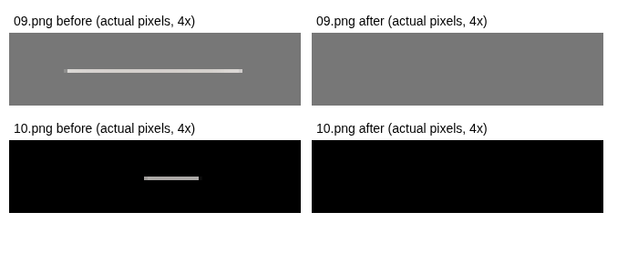

# 添付された09.png・10.pngの直接解析

## 入手・確認したもの

利用者が添付した`line_defect_09_10_for_codex.zip`を展開し、実際の`09.png`と`10.png`（ともに370×320px・RGBA PNG）を直接解析しました。今回の結果は合成画像だけの結果ではありません。実画像全体はリポジトリに追加せず、再発テストには線部分の実RGBA値と元PNGのSHA-256を収録しています。

## 確定した線の座標・色・透明度

座標は左上が(0, 0)。アルファ値0は完全透明、255は完全不透明です。RGBは線成分内の最小〜最大値で、純白ではありません。

| 画像   | X範囲    | Y   | 寸法・画素数   | R        | G        | B        | アルファ値             |
| ------ | -------- | --- | -------------- | -------- | -------- | -------- | ---------------------- |
| 09.png | 155〜203 | 25  | 49×1px・49画素 | 225〜235 | 219〜232 | 215〜229 | 54〜221（47画素が221） |
| 10.png | 177〜192 | 10  | 16×1px・16画素 | 232〜236 | 229〜232 | 225〜232 | 11〜187（14画素が187） |



8近傍の連結成分として、それぞれ本体・葉・文字から完全に離れた横1列です。09の線は最大不透明度約86.7%、10は約73.3%。端の画素だけ弱い不透明度になっています。白色だけを閾値で消すと見落とす色ですが、現行の検出器は色ではなくアルファ値で連結成分を調べるため、**今回の両方の実線を修正前のmainでも検出できました**。

10.pngの左右のハートは、別の連結成分（左79・上108px／23×21px・351画素、左269・上130px／23×21px・354画素）です。従来はこれらも削除候補になっており、利用者が誤選択する余地がありました。葉は本体の連結成分に含まれています。文字も線とは別の大きい成分です。

## 発生原因として確定した範囲と未確定の範囲

- 入手時点の完成PNGに半透明の線が存在します。今回PNGを読み込んだテストが新しく作った線ではありません。
- 自動透過は透明な角を持つPNGの白い本体・装飾を保護する既存仕様です。このため、透過済みPNG中の孤立線も自動では消しません。
- 現行の候補検出は線を検出できますが、検出と削除は別です。利用者が承認するまでは、正しい装飾を守るため出力にも残します。
- 範囲外を補間して線が混入する問題は前回までの修正・回帰テストで対処しています。しかし、今回の完成PNGだけから「元の一覧画像にあった線」「分割境界や縮小・Canvas補間で入った線」のどちらかを断定することはできません。線の色・端の半透明は補間とも矛盾しませんが、証明にはなりません。
- **発生工程を確定するには、加工前の一覧画像と、そのときの分割・透過・切り抜き・倍率設定（保存JSONがあればそれも）の比較が必要です。** 出力2枚だけを根拠に分割や文字合成の正常動作を変更していません。

## 今回のコード修正

- `residue.js`：成分ごとのアルファ最小・最大を記録。線の色に依存せず検出する既存方式を維持。
- 同ファイル：細長くない、幅・高さがともに5px以上、面積25画素以上、外周に触れない独立成分は、まとまった装飾候補として保護。今回の左右のハートを保護できることを実画像で確認。意味を認識するAIではなく、保護を優先した形状判定です。
- 保護候補はUIでチェック不可とし、削除APIでも選択を拒否。単なる見た目の無効化だけにしていません。保護候補は完成PNGの残留警告からも除外します。形状で判断できない小さい葉・点などは残るため、自動削除は引き続き行いません。
- `app.js`：元画像の座標・寸法・不透明度を候補に表示。削除可能な候補と保護した装飾の件数を分け、保護枠を緑で表示。
- 分割、文字デザイン、自動配置、拡大・位置調整、背景透過、出力の描画処理は変更していません。変更したJSは同じ新バージョン参照にしています。

## 修正PNG・ZIPの確認

1. アプリと同じ`StampResidue.analyse`・`removeSelected`を使い、既知の49×1px／16×1px成分だけを承認削除。
2. 元の370×320pxの配置を保った修正PNGを作成。削除した線のRGBAをすべて0とし、**それ以外の全RGBAバイトが元画像と完全一致**することを検査。葉・輪郭・顔・文字・ハート・影を含む他の部分は不変です。
3. 修正09.png／10.pngをZIP化し、ZIPを再展開してPNGが単体ファイルとバイト一致すること、CRCが正しいことを確認。
4. 別途、実画像をアプリの1列×1段で2枚読み込み、iPhone相当の画面で線を選択削除。左右のハートがチェック不可、他のネイティブ透明度が全画素不変、取り消し・やり直しが一致することを確認。
5. アプリの単体PNG・一覧Canvas・ZIP内PNGを独立して復号し、RGBAのSHA-256が一致することを確認。メイン・タブを含む4画像すべてで、上部の孤立した細い横線が0件であることを検査。

元の配置を保った修正ZIPは`09.png`と`10.png`の2枚だけの修正用ZIPです。申請用一式ではありません。アプリへ2枚だけを新しく読み込んだテストでは、既存の固定番号ルールに従い01・02に割り当てられ、メイン・タブ付きのテストZIPを生成しています。この保存形式は変更していません。

## 自動テストと再実行

```sh
node --test tests/core.test.cjs tests/project.test.cjs tests/typography.test.cjs tests/residue.test.cjs tests/real-line.test.cjs
# フル実画像の09.png / 10.pngを保持するフォルダーを指定（画像はローカル処理のみ）
NODE_PATH=/tmp/stamp-browser-tests/node_modules STAMP_TEST_URL=http://127.0.0.1:4400 STAMP_REAL_FIXTURES=/tmp/stamp-real-defects STAMP_TEST_ARTIFACTS=/tmp/stamp-real-results node tests/real-png-browser.cjs
python3 tests/verify_real_app.py /tmp/stamp-real-results
python3 tests/repair_real_pngs.py /tmp/stamp-real-defects /tmp/stamp-real-corrected
```

- 通常の単体テストは実際の線のRGBA値を収録した小さいJSONを使用するため、フル画像がなくても再実行可能です。34件が通過。
- フル実画像のブラウザ検証、修正PNG・ZIPの独立復号検証も実行しました。
- 既存の10／40枚、8／16／24／32／40枚、自由分割、文字デザインと配置、消しゴム、比較、JSON、メイン・タブ、ZIPの回帰検証も実行。詳細は最終報告と各テスト出力で区別しています。
- **実機iPhone Safariは未検証**です。ChromiumのiPhone 13相当の画面・タッチ入力で確認。元一覧画像がないため、元工程の原因断定も未確認です。
