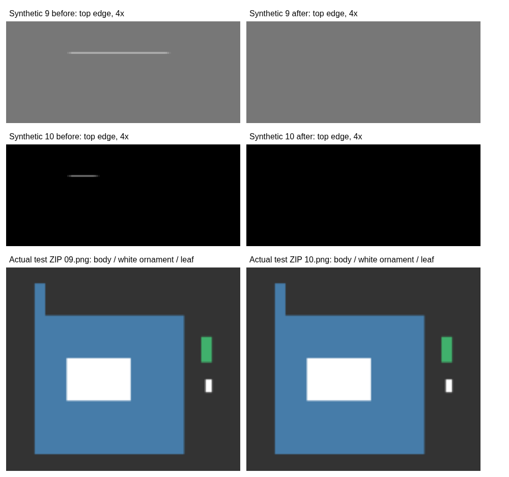

# 上端の白線：調査と回帰テスト

この文書は実画像入手前の調査記録です。添付後の直接解析・修正結果は[実PNGの最新報告](real-png-line-investigation.md)を参照してください。

続く検出漏れと49×1px／16×1pxの正確な再現については、[追加調査](exterior-horizontal-residue-investigation.md)を参照してください。

## 確認できた範囲

利用者の実際のテストZIP、09.png、10.png、元画像はこの作業環境にありません。報告された約49px／約15pxの線について、その画像固有の原因と修正結果は未確認です。本書の「修正前後」はすべて、コードで作成した再現用画像による結果です。実機iPhone Safariも未検証です。ChromiumのiPhone 13相当の画面・タッチ入力で検証しました。

## 工程ごとの調査

| 工程                       | 確認・変更                                                                                                                                                                                                                                                                                                                                  |
| -------------------------- | ------------------------------------------------------------------------------------------------------------------------------------------------------------------------------------------------------------------------------------------------------------------------------------------------------------------------------------------- |
| 読込・画像分割             | 読込時の最大辺2560px、各コマの最大辺600pxへの縮小は既存仕様。分割領域を指定して直接縮小すると、補間が隣の領域を参照できるため、整数画素でいったん別Canvasに切り出してから縮小するよう変更。隣コマの白線を持つ1800×1200pxの合成画像で、混入0を検査。読込時点の縮小や元画像で既に混ざった画素は、切り抜き調整・候補確認・消しゴムで確認する。 |
| 背景透過                   | 外周からの連結背景除去は既存方式を維持。ただし自動モードで透明な角がある画像は、既に透過済みと判断し元の透明度を保持するよう変更。輪郭線のない白い本体や独立した白い装飾の誤消去を防ぐ。白背景が残る場合は利用者が明示的に「白」などを選べる。                                                                                              |
| 拡大・位置調整・Canvas描画 | `drawImage`に元Canvasと切り抜き矩形を渡す旧処理で、矩形の外の白線が補間によって上端に復活することを再現。マスク適用後に切り抜き領域を1:1で別Canvasへ物理的に分離し、そのCanvasだけを拡大する。文字の自動配置・キャラクター自動縮小の描画でも同じ分離済み画像を使う。元画像の色・マスクを削って隠す処理ではない。                            |
| 元画像に残る線             | 切り抜き領域の内側の前景は、必要な装飾と判別できない。8近傍連結成分を解析し、最大成分の外側にある小さい／細長い／外周の成分を候補として表示する。透明度1の点も対象。検出自体は画素を一切変更しない。最大成分、内部の目、斜めにつながる手足は候補から除外する。                                                                              |
| 消しゴム・選択削除         | 選択した成分の透明度だけを既存のマスクに記録。消しゴムと共通の取り消し／やり直し、JSON差分保存、最終描画を使う。検出後にマスクが変わった場合は古い候補での削除を拒否する。                                                                                                                                                                  |
| PNG・ZIP                   | 編集・拡大確認・一覧・PNG・ZIPは同じ`renderStamp`を使用。確認用の背景・候補枠・番号は別要素／別Canvasに描き、PNGに含めない。PNG符号化が白線を作り出した証拠は得られていない。実ZIPのPNGをPythonで独立して復号し、40枚すべての一覧CanvasのRGBA SHA-256と一致することを検査。                                                                 |

## 再現画像の比較

120×120pxの透明画像に青い本体と上端の白線を描き、上1pxを切り抜いて拡大。旧描画と新描画を同じ配置で比較しました。元画像の白線は18px／5pxで、報告画像そのものではありません。

| 再現ケース             | 旧描画：完成PNG上端付近の白画素 | 修正後 |
| ---------------------- | ------------------------------: | -----: |
| 09相当（元の白線18px） |                      横一列51px |    0px |
| 10相当（元の白線5px）  |                      横一列16px |    0px |



別のテストでは、切り抜き範囲内に白線18px／5px、白い本体、独立した白い装飾、緑の葉っぱを配置。既定では線も装飾も残ります。09相当は候補を利用者操作で選択削除、10相当はタッチ消しゴムで削除しました。両方で線以外の透明度の全バイトが一致し、取り消しで元の完成Canvas、やり直しで削除後のCanvasに完全一致することを検査しています。

グレー／黒背景、1・2・4・8倍表示、候補への拡大移動、390px幅を保ったスクロールを検査。背景・倍率変更でも完成Canvasは変化しません。8／16／24／32／40枚で同じ解析・マスク変更・PNG／ZIP処理を実行し、番号、寸法、CRC、余白、白い本体・装飾・葉っぱの保持、上端の線消失を確認しました。既存の10枚テストZIP、自由分割、文字デザインと自動配置、個別編集、JSON再読込、メイン・タブ画像の回帰テストも実施しています。

## 安全上の限界と使い方

画像だけで線と装飾を必ず見分けることはできません。候補に浮いた手足・葉・白い装飾が含まれる場合があります。**自動削除・初期選択・全選択はありません。** 不要だと目視確認した候補だけを選び、確認ダイアログの後で削除します。誤った選択は「1つ戻す」で戻せます。候補がない場合も不要部分がない保証にはなりません。線が本体とつながっている場合などは、切り抜き調整または消しゴムで確認します。

解析は文字合成前の前景を対象とするため、文字・白フチ・影は削除候補にしません。最終確認は文字入りの完成プレビューと一覧で行います。実際の09.png・10.pngを使った再検証と、実機Safariでの画像読込・拡大・ブラシ・ZIP保存は残っています。

## 再実行

READMEのローカルサーバーとPlaywright設定で、以下を実行します。生成物は既定で`/tmp/stamp-test-artifacts`へ保存し、元の不具合画像とは区別しています。

```sh
node --test tests/core.test.cjs tests/project.test.cjs tests/typography.test.cjs tests/residue.test.cjs
NODE_PATH=/tmp/stamp-browser-tests/node_modules node tests/residue-browser.cjs
python3 tests/verify_residue_zip.py /tmp/stamp-test-artifacts
```

生成物：`residue-evidence.json`、`residue-before-9.png`／`residue-after-9.png`（10も同様）、黒／グレーの拡大確認スクリーンショット、`residue-fixed-40.zip`、`residue-preview-hashes-40.json`、`residue-count-{8,16,24,32,40}.zip`。
